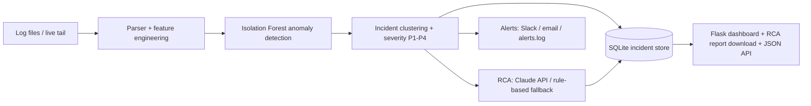

# Incident Triage AI

A Python tool that acts as a "software detective": it reads application logs, detects anomalies with machine learning, groups them into incidents, assigns severity (P1-P4), generates root-cause analysis with Generative AI, escalates critical issues, and tracks each incident to resolution.

## Architecture



## Run it

```bash
pip install -r requirements.txt
python sample_logs/generate.py        # creates sample_logs/app.log
python app.py                         # open http://127.0.0.1:5000 and upload the log
python monitor.py sample_logs/app.log 10   # live monitoring mode
pytest                                # run tests
```

Optional environment variables: `ANTHROPIC_API_KEY` (enables LLM root-cause analysis; without it a rule-based knowledge base is used), `LLM_MODEL`, `SLACK_WEBHOOK_URL`, `SMTP_HOST`, `SMTP_PORT`, `SMTP_USER`, `SMTP_PASS`, `ALERT_TO`.

## How it maps to application support work

| Support skill | Where |
|---|---|
| Python, debugging, stack-trace handling | `core/pipeline.py` (multi-line trace parsing) |
| Log analysis and root cause analysis | `pipeline.py`, `rca.py` |
| Monitoring system performance | `monitor.py` (live tail, rolling window) |
| Incident management and escalation | `store.py` (status workflow), `alerts.py` (P1/P2 alerts) |
| Documentation / knowledge sharing | auto-generated RCA reports (`/report/<id>`) |
| Generative AI | `rca.py` (LLM with fallback) |
| Solution architecture | diagram above, modular `core/` package |

## Resume bullets (replace the [X] with your own measured results)

- Built an end-to-end incident triage tool in Python/Flask: log parsing, Isolation Forest anomaly detection, incident clustering and P1-P4 severity scoring across **[X]** log lines.
- Integrated an LLM API to generate root-cause analysis and fix suggestions, with a rule-based fallback; auto-generated downloadable RCA reports.
- Implemented SQLite incident tracking (open/acknowledged/resolved), de-duplication, live log monitoring and Slack/email escalation for critical incidents.
